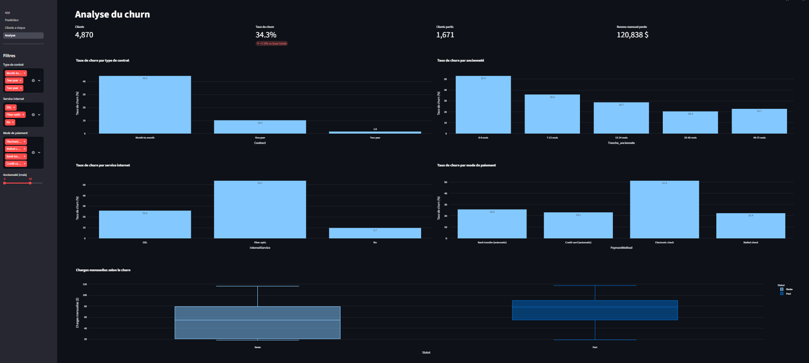
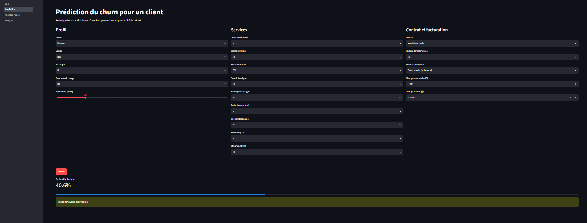
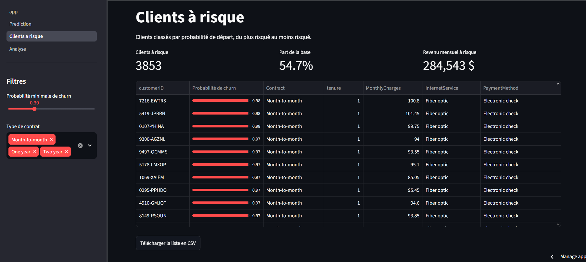

# Prédiction du churn client (Telco)

Dans ce projet, je cherche à repérer les clients d'un opérateur télécom qui risquent de partir. J'ai analysé les données, comparé trois modèles et mis le meilleur dans un dashboard.

**Dashboard en ligne : https://customer-churn-prediction-ljtqpfp8heqbjzvsmggjda.streamlit.app**

## Objectif
Identifier les clients susceptibles de partir (churn) afin de cibler des actions de rétention.

## Données
Telco Customer Churn (IBM, via Kaggle) : 7 043 clients, 20 variables (contrat, ancienneté, facturation, services). Taux de churn global : 26,5 %.

## Méthodologie
1. **Analyse exploratoire** (`notebooks/01_eda.ipynb`) : nettoyage, taux de churn par segment.
2. **Modélisation** (`notebooks/02_modeling.ipynb`) : pipeline scikit-learn, comparaison de 3 modèles avec gestion du déséquilibre de classes.
3. **Interprétabilité** (`notebooks/03_shap.ipynb`) : valeurs SHAP.
4. **Dashboard** (`app/`) : Streamlit, 3 pages.

## Résultats
| Modèle | ROC-AUC | Recall (churn) | Precision (churn) |
|---|---|---|---|
| Régression logistique | 0,8415 | 0,78 | 0,50 |
| Random Forest | 0,8417 | 0,77 | 0,54 |
| XGBoost | 0,8423 | 0,79 | 0,51 |

Les trois modèles ont des performances équivalentes. J'ai retenu XGBoost pour son meilleur recall et sa compatibilité avec SHAP.

## Principaux enseignements
- Contrat mensuel : 42,7 % de churn, contre 11,3 % (1 an) et 2,8 % (2 ans).
- Le churn se concentre sur les premiers mois d'ancienneté.
- Facteurs de risque : charges mensuelles élevées, fibre optique, paiement par electronic check, absence de sécurité en ligne et de support technique.
- Ces résultats montrent des associations, pas des causalités.

## Dashboard
- **Analyse** : KPIs et graphiques filtrables.
- **Prédiction** : probabilité de churn pour un client.
- **Clients à risque** : liste triée, exportable en CSV.





## Lancer le projet en local
```bash
git clone https://github.com/nesrinelat/customer-churn-prediction.git
cd customer-churn-prediction
python -m venv venv
venv\Scripts\activate
pip install -r requirements.txt
python -m streamlit run app/app.py
```

## Technologies
Python, pandas, scikit-learn, XGBoost, SHAP, Plotly, Streamlit.